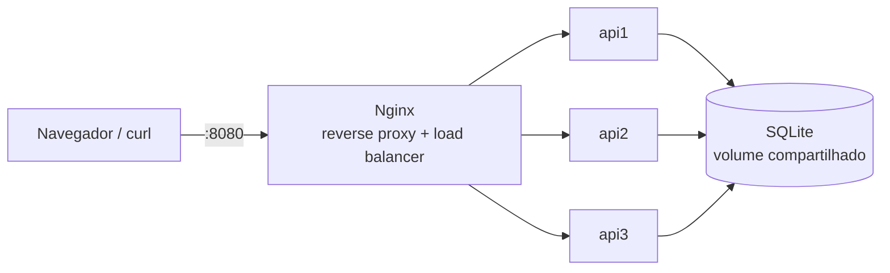

# Arquitetura

## Visão geral



Cada réplica é a mesma imagem Docker (Express). O Nginx distribui as requisições em round-robin, repassa o IP real do cliente (`X-Forwarded-For`) e tenta outra réplica se uma falhar (`proxy_next_upstream`). A API também serve o painel web estático (`public/`), então não há CORS entre frontend e backend.

Camadas da aplicação (cada requisição atravessa nesta ordem):

```
rota -> middlewares (auth, papel, validação) -> controller -> service -> model -> SQLite
```

- **routes**: mapeiam URL + método e encadeiam os middlewares.
- **controllers**: traduzem HTTP (status, JSON); não têm regra de negócio.
- **services**: regras de negócio e autorização por objeto (ex.: "membro só vê o próprio treino"), cache.
- **models**: SQL parametrizado (nunca concatenação de strings).

## Pipeline de middlewares

Ordem de execução em `app.js` e responsabilidade de cada camada:

| # | Middleware | Responsabilidade |
|---|---|---|
| 1 | `helmet` | Cabeçalhos de segurança: CSP, `nosniff`, `X-Frame-Options`, remove `X-Powered-By`. |
| 2 | `instanceMiddleware` | Adiciona `X-Instance-Id` com a réplica que atendeu. |
| 3 | `cors` | Restrito: sem `CORS_ORIGIN` só aceita o mesmo domínio. |
| – | `express.static` e `/health` | Servem o painel e o health check, antes do log e dos limites para não poluí-los. |
| 4 | `loggerMiddleware` | Log por requisição: data/hora, instância, método, URL, status, tempo, IP e usuário. |
| 5 | `apiLimiter` | Máximo de requisições por minuto por IP (429 ao exceder). |
| 6 | `express.json({limit:'10kb'})` | Parser de JSON com limite de tamanho (413 se exceder). |
| 7 | `sanitizeMiddleware` | Remove caracteres de controle e tags HTML, normaliza Unicode, aplica `trim`, descarta `__proto__`/`constructor`/`prototype`, limita profundidade. Não altera senhas. |
| 8a | `authLimiter` | Só em `/api/auth`: limite rígido de tentativas falhas (contra força bruta). |
| 8b | `authMiddleware` | Valida o JWT (algoritmo fixo HS256) e preenche `req.user`. |
| 8c | `roleMiddleware` | Autorização por função (admin/trainer/member). |
| 8d | `validationMiddleware` | Valida o corpo com Zod (tipos, tamanhos, formatos); campos desconhecidos são descartados. |
| 9 | `errorMiddleware` | Último da cadeia. Resposta padronizada `{error}`, códigos HTTP corretos, sem stack trace ao cliente (fica só no log do servidor). |

A sanitização vem **antes** da validação de propósito: a validação enxerga o dado já limpo. A proteção principal contra XSS continua sendo a codificação na saída (o frontend usa `textContent`) e a CSP.

## Tratamento de erros

Formato único: `{ "error": "mensagem" }`; erros de validação acrescentam `details: [{field, message}]`.

| Situação | Código |
|---|---|
| JSON malformado, dados inválidos, ID inválido | 400 |
| Sem token, token inválido/expirado, login errado | 401 |
| Sem permissão (papel ou objeto de outro usuário) | 403 |
| Recurso não encontrado, rota inexistente | 404 |
| E-mail já cadastrado | 409 |
| Corpo grande demais | 413 |
| Limite de requisições excedido | 429 |
| Erro interno (mensagem genérica; detalhe só no log) | 500 |

## Persistência e migrações

- **SQLite** (arquivo único, modo WAL, `foreign_keys=ON`, `busy_timeout=5000`). Escolhido pela simplicidade de execução e reprodutibilidade; o trabalho foca na aplicação dos conceitos, não em escala de banco.
- **Migrações versionadas** em `migrations/NNN_nome.js`, executadas em ordem na inicialização e registradas na tabela `schema_migrations`. Cada migração roda numa transação. Bancos criados antes do versionamento são aceitos (as migrações usam `IF NOT EXISTS`).
  - `001_initial_schema`: users, members, workouts, checkins
  - `002_checkins_legacy_fix`: corrige o formato antigo de checkins (no-op em bancos novos)
  - `003_add_indexes`: índices em `workouts.member_id`, `workouts.trainer_id`, `checkins.member_id`, `checkins.checkin_date`
- `npm run migrate` aplica as pendentes e lista as versões.
- Todas as consultas usam parâmetros (`?`).

## Cache

- **Onde:** listagem de treinos (`GET /api/workouts`), a consulta mais lida e mais cara (JOINs com membros e usuários).
- **Estratégia:** cache-aside em memória, TTL de 30 s (`CACHE_TTL_SECONDS`; 0 desativa).
- **Invalidação explícita:** `POST`, `PUT` e `DELETE` de treinos apagam a chave `workouts:list`.
- **Visibilidade:** a resposta traz `X-Cache: HIT` ou `MISS`; o painel exibe isso na faixa inferior.
- **Não é cacheado** o que depende do usuário (`/mine`, `/:id`), para não misturar dados entre pessoas.
- **Limitação conhecida:** com várias réplicas cada uma tem seu cache. Uma escrita invalida só o cache da réplica que a recebeu; as demais ficam desatualizadas por, no máximo, o TTL (30 s). Aceitável para este contexto; a evolução natural é um Redis compartilhado.

## Load balancing

- `docker-compose.yml`: `api1`, `api2`, `api3` (mesma imagem, `INSTANCE_ID` diferente) atrás do Nginx (`nginx/nginx.conf`).
- Algoritmo round-robin; `max_fails`/`fail_timeout` retiram do pool uma réplica com falha.
- Health checks: o Compose só sobe o Nginx quando as três réplicas estão saudáveis (`/health` consulta o banco).
- `api2` e `api3` esperam `api1` ficar saudável, porque é ela que aplica as migrações.
- O Nginx também limita `/api/auth/` a 20 req/min por IP. Isso complementa o limitador da aplicação, que é por réplica (cada uma conta separado).
- **Limitação conhecida:** as réplicas compartilham um único arquivo SQLite por volume. Funciona (WAL + `busy_timeout`) para a carga deste trabalho, mas em produção real o certo é um banco cliente-servidor (PostgreSQL).

## Decisões técnicas

| Decisão | Justificativa |
|---|---|
| Node.js + Express | Stack já dominada pelo grupo; ecossistema simples para middlewares. |
| SQLite com SQL direto | Zero configuração e reprodutível em qualquer máquina; queries parametrizadas dispensam ORM. |
| JWT de 2 h, algoritmo fixo | API sem estado, ideal para várias réplicas sem sessão compartilhada. |
| Zod | Validação declarativa; descarta campos não esperados. |
| Autorização em duas camadas | Papel no middleware (barato) e objeto no service (precisa do dado). |
| Frontend em HTML/CSS/JS puros | O enunciado diz que o foco é o backend; sem build nem dependências, servido pela própria API. |
